<div align="center">
  <picture>
    <source media="(prefers-color-scheme: dark)" srcset="assets/terminal-dark.svg">
    <source media="(prefers-color-scheme: light)" srcset="assets/terminal-light.svg">
    
  </picture>
</div>

<br>

<div align="center">

```bash
bani@dev:~$ ./quick-launch --interactive
```

[](https://arunastudio.site)
[](https://github.com/baniputrabangsawan/pilah-yuk)
[](https://baniputrabangsawan-portfolio.vercel.app)

[](https://linkedin.com/in/baniputrabangsawan)
[](https://instagram.com/baniputra__)
[](mailto:baniputrabangsawan11@gmail.com)

</div>

<br>

<details>
  <summary><b><code>❯ ./diagnostics --expanded-tech-stack</code></b></summary>
  <br>

  <p align="center">
    
    <br>
    
  </p>
</details>

<details>
  <summary><b><code>❯ ./diagnostics --activity-graph</code></b></summary>
  <br>

  <p align="center">
    
  </p>
</details>

<br>

<div align="center">
<sub>⚡ Hermes Terminal Agent v2.6.4 · Maintained by <b>Bani Putra Bangsawan</b> · <code>exit 0</code></sub>
</div>
